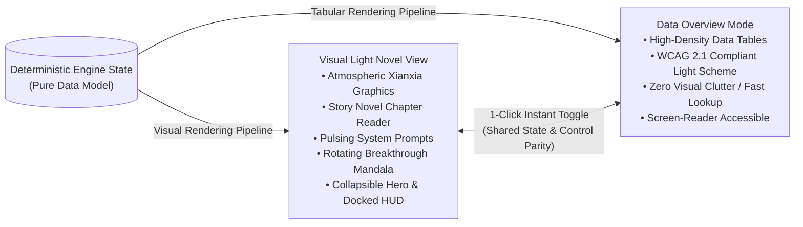
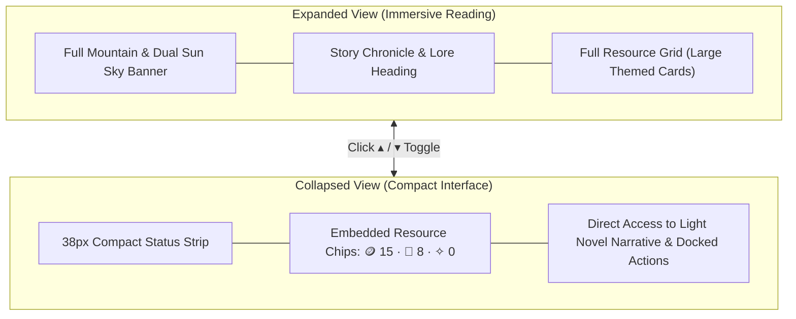

# ✧ ISEKAI IDLE · 异界修真 ✧

<div align="center">

[](file:///tests)
[](file:///package.json)
[](file:///game.js)
[](file:///visual.css)
[](file:///i18n.js)

**A causal, story-rich Xianxia incremental RPG built with Zero External Dependencies.**  
*From a crippled mortal awakening beneath alien suns to the sovereign guardian of an interconnected galaxy.*

[**Play Online (GitHub Pages)**](https://duntik.github.io/Isekai-Idle/) • [**Design Architecture**](design/README.md) • [**Cloud Setup**](CLOUD_SETUP.md)

</div>

---

## 🌟 Overview

**Isekai Idle** is a browser-based cultivation incremental game inspired by classic eastern fantasy and light novels such as *Against the Gods* (ATG / Восставший против неба), *Mushoku Tensei*, and *By the Grace of the Gods*.

Unlike traditional idle games that rely on artificial exponential inflation and mindless timers, **Isekai Idle** is built around an **interactive episodic novel engine**, deep **causal memory**, a **living fog-of-knowledge atlas**, and **strict mathematical determinism**.

Every chapter unlocks completely new gameplay systems; previous achievements never become obsolete, transitioning into automated supply lines that fuel higher realms.

```mermaid
flowchart TD
    subgraph C1["Chapter 1: The Outcast (Mortal Realm)"]
        A["Mortal Reincarnation in Mud & Clay\n(Crippled Channels · Truck Crash)"] --> B["Physical Body Tempering\n(Direct Squats & Stance Conditioning)"]
        B --> C["Sky Poison Pearl Awakening\n(Spiritual Echo & Vessel Diagnostics)"]
        C --> D["Meditation & Mental Calm\n(Neural Calibration & Ancient Resonance)"]
        D --> E["Sanctuary Ruins Exploration\n(Tablet of the Evil Sky Sutra)"]
        E --> F["100% Pure Herb Alchemy\n& Meridian Breakthrough"]
        F --> G["Bridge Threat Confrontation\n(Combat · Service · Diplomacy)"]
        G --> H["The Grand Recruitment\n(Choose 1 of 4 Great Sects)"]
    end
    subgraph C2["Chapters 2–3: The Cultivator & Disciple"]
        H --> I["Sect Apprenticeship & Library Research"]
        I --> J["Elemental Martial Styles\n(Swift · Armored · Mystic Counters)"]
        J --> K["Sect Tournaments & World Atlas Surveys"]
    end
    subgraph C3["Chapters 4–8: Cosmic Sovereign"]
        K --> L["Sect Leadership & Alchemy Production"]
        L --> M["Trade Districts & Caravan Supply Routes"]
        M --> N["Interworld Shield & Planetary Portals"]
        N --> O["Interstellar Fleet & Colony Expansion"]
        O --> P["Observatory of Cosmic Laws & Soul Rebirth"]
    end

    classDef c1 fill:#162a28,stroke:#2edba2,stroke-width:1.5px,color:#edf0e8;
    classDef c2 fill:#182836,stroke:#38bdf8,stroke-width:1.5px,color:#edf0e8;
    classDef c3 fill:#2d1e2f,stroke:#e5c382,stroke-width:1.5px,color:#edf0e8;
    class A,B,C,D,E,F,G,H c1;
    class I,J,K c2;
    class L,M,N,O,P c3;
```



---

## ⚡ Key Highlights

### 1. 📖 Interactive Light Novel Engine
Read and participate in an authentic cultivation narrative. Rather than wall-of-text dumps, the story unfolds through episodic chapters with dynamic micro-events that react to your training, discoveries, and moral choices.
* **Typographic Controls**: Toggle between atmospheric serif (`Prata`) and clean sans (`Manrope`), with customizable large-text reading modes.
* **Chapter Chronicle**: Past milestones and decisive choices are immortalized in your personal chronicle log.

### 2. 🔮 Evolving In-Universe System Prompts
Say goodbye to omniscient video-game quest logs like *"Your Objective: Click 10 times"*. In **Isekai Idle**, guidance is delivered via the awakening of the **Sky Poison Pearl** embedded in your left palm:
* **Step 0 (Awakening)**: `✦ SURVIVAL INSTINCT` — Pure mortal grit. No system, no brackets. Cold rain, crippled body, and survival dilemma.
* **Step 1 (First Echo)**: `【 SKY POISON PEARL · FIRST ECHO 】` — Shimmering emerald runes glitch into vision. The protagonist panics (*"Is this sunstroke or madness?!"*).
* **Step 2 (Vessel Diagnostics)**: `【 INSIGHT SYSTEM · VESSEL DIAGNOSTICS 】` — Analytical alerts evaluate flaws in the physical vessel and mandate body rank 2.0.
* **Step 3 (Calibration)**: `【 INSIGHT SYSTEM · SYNCHRONIZATION 】` — Meditation with Old Zhen steadies the neural link, mapping coordinates to an ancient seal.
* **Steps 4–7**: Advanced ruins scanning, 100% purification breakthrough protocols, tactical bridge threat evaluation, and sect affinity analysis.

### 3. ☯ Dual-Interface Architectural Parity
Switch instantly between two full-featured presentation modes with **zero state loss**:
* **Visual Novel View**: Dark jade and crimson tones, floating cloud valley banner with dual pale suns, SVG sect emblems, rotating meridian breakthrough mandalas, and floating damage numbers.
* **Data Overview (Tabular View)**: Clean, high-density light-theme data tables designed for rapid information scanning, office-friendly play, and full screen-reader accessibility.



### 4. 🧭 Fog of Knowledge & World Atlas
Unexplored locations begin enshrouded in true fog of war. Gain intelligence through:
* **Heard Rumors**: Town tavern chatter reveals hints and danger ratings.
* **Field Surveys**: Active reconnaissance discovers hidden mountain trails (cutting travel time by 20%) and records local herbal/mineral resources.
* **NPC Memory**: Characters remember whether you helped them, accepted their contracts, or left them behind.

### 5. ⛩ The 4 Great Sects
In Chapter 1 Step 7, reach Crescent City gates at the Silver Bridge and align with one of four ancient schools:

| Sect | Insignia | Doctrine | Unique Perk | School Rule |
|:---|:---:|:---|:---|:---|
| **Jade Grove** (*Rescue*) | 🌿 Dew Ring | Compassion, medicine, life preservation | Herb gathering ×1.5, +20% potion potency | Non-aggression: No unprovoked bloodshed |
| **Cloud Reach** (*Remains*) | 🗡 Flying Blade | Swift heavenly currents, wind dao | Travel time −25%, dodge counter attacks | Absolute non-attachment to worldly possessions |
| **Empty Sky** (*Invitation*) | ☯ Void Ba-Gua | Ancient void scripture, profound insight | Qi accumulation ×1.35, mastery acceleration | Strict solitary cultivation intervals |
| **Stone Bastion** (*Gates*) | 🏛 Basalt Gate | Iron physique, immovable mountain | Body conditioning ×1.5, damage barrier | Protect caravan routes and mortal outposts |

---

## 🗺 Grand Horizon Progression (Chapters 1–8)

| Stage | Chapter Title | Core Theme & Unlocks | Realm Cap | Primary Economic Engine |
|:---:|:---|:---|:---:|:---|
| **I** | **The Outcast** (*Чужак*) | Mortal survival, yard sweeping, body tempering, Sky Poison Pearl awakening, ruins exploration, meridian breakthrough | Mortal 0–1 | Manual labor, Mei's tavern contracts |
| **II** | **The Cultivator** (*Практик*) | Elemental martial styles, weapon forging, technique rank mastery, martial encounters | Realm 1–3 | Herb gathering, wandering contracts |
| **III** | **The Disciple** (*Ученик*) | Sect library research, reputation accumulation, arena tournament challenges | Realm 4–6 | Sect missions, library speed multipliers |
| **IV** | **Sect Master** (*Глава секты*) | Disciple recruitment, assignments (gardeners, lumberjacks, miners, alchemists), hall construction | Realm 7–9 | Automated herb, wood, ore & pill production |
| **V** | **The Grand City** (*Город*) | Urban districts, granaries, permanent trade caravans, merchant guild contracts | Realm 10–12 | Caravan trade routes, supply logistics |
| **VI** | **Planetary Node** (*Планета*) | Planetary defense shield, spirit nexus arrays, interworld transition portals | Realm 13–15 | Interworld essence generators |
| **VII** | **Star Sovereign** (*Звёздная держава*) | Astral shipyard, cosmic fleet construction, colonial expeditions to distant worlds | Realm 16–18 | Multi-world colonial harvesting |
| **VIII** | **Galactic Core** (*Галактика*) | Cosmic law observatories, universal comprehension, Celestial Soul Rebirth | Realm 19–24+ | Soul reincarnation legacy bonuses (+10%/soul) |

---

## 🎮 Gameplay Systems & Mechanics

### Physical Body vs. Spiritual Insight
* **Body Conditioning**: Unlike many idle games, the physical body **cannot be trained passively**. Strengthening sinews and bones requires conscious physical effort (squats, stone stance, running drills).
* **Meditation & Insight**: Passive breathing and tranquility nurture the soul, accumulating Insight and Spiritual Qi. Manual physical labor temporarily interrupts meditation.
* **Deterministic Battles**: Combat calculations are 100% deterministic with zero RNG coinflips. Match your active style against your opponent's stance (+35% counter bonus) to guarantee victory.

### Compact Interface Reduction
Click the top toggle (`▴` / `▾`) on the hero banner to collapse the interface:
* The 320px hero banner shrinks into a sleek 38px status bar.
* The large grid of resource cards is tucked away, with all active balances (Coins, Herbs, Qi, Shards) embedded directly into compact glowing status chips.
* The sticky Mini-HUD keeps track of your stamina and resources while scrolling through long novel passages.



---

## 🛠 Technology Stack & Design Principles

* **Zero Build Tools**: No Webpack, Vite, Babel, or NPM dependencies. Simply clone and open `index.html`.
* **Pure Web Standards**: Modern ES2022 JavaScript, semantic HTML5, and native CSS custom properties.
* **Vector Graphics**: Pure inline SVG art for sect insignias, breakthrough mandalas, and celestial landscapes.
* **Offline Calculation**: Deterministic elapsed-time simulation supporting up to 24 hours of background progression.
* **State Preservation**: Safe versioned JSON migrations (`isekai-idle-v2`), compressed save codes, 8 local backup slots, and optional Supabase cloud synchronization.

---

## 🧪 Comprehensive Verification Suite

The repository includes **39 deterministic test suites** powered by the native Node.js test runner (`node:test`):

```bash
# Run all 39 test suites
node --test *.test.js
```

### Test Suite Directory

| Test File | Verification Scope |
|:---|:---|
| `achievements.test.js` | 41 milestone definitions, unlock criteria, death persistence, offline parity |
| `activity-compatibility.test.js` | Exclusive activities, manual action interruptions, travel restrictions |
| `admission.test.js` | 4 sect admission routes, prerequisites, unique gifts, migration |
| `atlas.test.js` | Fog of war, rumor verification, survey rewards, trail discoveries, map pins |
| `automation.test.js` | Training routine automation, local work requirements, offline safety |
| `causal-events.test.js` | Branching narrative consequences, deterministic replay, bilingual metadata |
| `chapter-one.test.js` | Chapter 1 routes (Combat, Service, Diplomacy), guidance assertions |
| `choice-explanations-integration.test.js` | 3,599 choice previews in English and Russian, death safety |
| `choice-intent.test.js` | Danger transparency, honest outcome promises, practice limits |
| `director.test.js` | Anti-streak RNG safety over 200 seeds, persistent scene IDs |
| `employment.test.js` | Work contracts, manual payouts, cancellation, zero passive body gain |
| `encounters.test.js` | Local scene pools, no immediate repeats, unique story finds |
| `engine.test.js` | Core progression, realm breakthrough costs, offline/online balance |
| `exploration-risk.test.js` | Deliberate exploration, warnings before commitment, safe retreats |
| `fate-tree.test.js` | Story decision tree, karmic NPC bonds, unlocked faction chronicles |
| `generation.test.js` | 1,080 causal local scenes, peaceful advancement, attribution checks |
| `local-activities.test.js` | Location-dependent actions, temple discoveries, travel pauses |
| `localization.test.js` | 100% translation coverage, zero Cyrillic leakage in English mode |
| `location-knowledge.test.js` | Progressive fog of war, NPC visits, resource harvesting surveys |
| `location-popup.test.js` | Location detail modal, compact layout, backdrop dismissal |
| `names.test.js` | 240 bilingual name parts (4,800 combinations) across 3 distinct styles |
| `npc-memory.test.js` | Relationship persistence, mentor guidance, interaction recall |
| `opening-pacing.test.js` | Pacing across labor, herbal, and archival progression paths |
| `opening-paths.test.js` | 3 distinct Chapter 1 paths, non-combat options, save integrity |
| `place-journal.test.js` | Field observations, people records, bounded resource discoveries |
| `quest-places.test.js` | Discovered travel routes, parental unlocks, legacy visits |
| `return-report.test.js` | Offline calculation deltas, capped gains, bilingual summary dialog |
| `save.test.js` | Gzip save codes, Unicode safety, corruption resistance, cloud client |
| `sects.test.js` | 4 exclusive sects, library research bonuses, legacy technique retention |
| `sound.test.js` | 0 KB procedural Web Audio synthesis, singing bowls, breakthrough gong, safe headless fallback |
| `story-memory-integration.test.js` | Causal alternatives, one-time rewards, relationship persistence |
| `task-practice.test.js` | Technique practice limits, stamina expenditure, save compatibility |
| `technique-actions.test.js` | Active technique mechanics, contextual action triggers |
| `techniques.test.js` | 8 techniques, 5 ranks each, upgrade costs, offline practice |
| `travel-quests.test.js` | Courier routes, safe refusals, travel encounters, migration |
| `ui.test.js` | Dual-view control parity (Visual vs Data), tab switching, naming modal |
| `unusual-paths.test.js` | Optional vows, pacifist advancement, legacy uncertainties |
| `world.test.js` | World travel, encounter rotations, mentors, 50% resource loss on death |

---

## 🚀 Quickstart & Deployment

### Run Locally (Instant, No Install)
Simply open `index.html` in any modern web browser:
```bash
# Or serve using any static file server:
npx serve repository/
```

### Deploy to GitHub Pages
1. Go to repository **Settings** → **Pages**.
2. Under **Build and deployment** → **Source**, select **Deploy from a branch**.
3. Choose branch `main` and directory `/ (root)`.
4. Your game will be live at `https://<username>.github.io/<repository-name>/`.

### Cloud Synchronization (Optional)
To enable multi-device cloud saves via Supabase, refer to [**`CLOUD_SETUP.md`**](CLOUD_SETUP.md).

---

## 📜 License & Acknowledgments

This project is open-source. Inspired by the Xianxia novel genre, *Against the Gods* (Mars Gravity), *Mushoku Tensei* (Rifujin na Magonote), and incremental pioneers like *Evolve* and *Kittens Game*.
