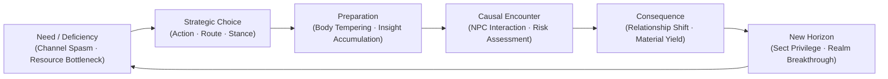
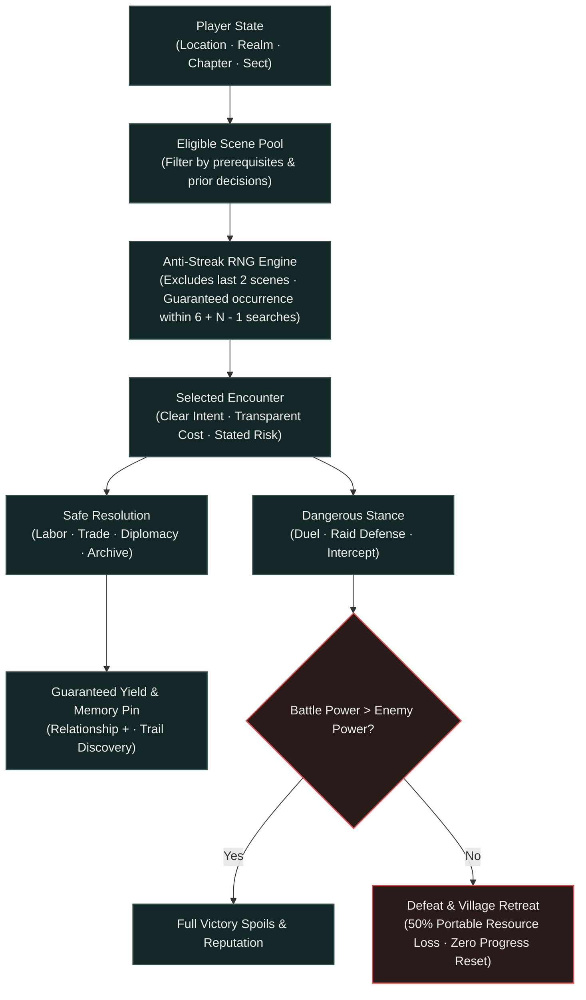

# ✧ Isekai Idle · Game Design Architecture ✧

**The architectural philosophy, narrative rules, and system blueprints of Isekai Idle.**  
*For player-facing mechanics and quickstart instructions, see the main [README.md](../README.md).*

---

## 🏛 Core Philosophy & Narrative Loop

Every major milestone fundamentally alters the protagonist's relationship with the world:
1. **Outcast & Survivor**: Desperately seeking food, shelter, and guidance to keep a broken body alive.
2. **Apprentice & Cultivator**: Earning library privileges, proving capability, and learning elemental martial forms.
3. **Master & Sovereign**: Leading disciples, orchestrating urban trade caravans, and constructing planetary defense arrays.

### The Causal Progression Loop

Long-term engagement is driven by **new systemic decisions and narrative discoveries**, never by artificially inflating timer lengths on a single repetitive action.

---

## 📐 Invariant Design Rules

These principles govern all mechanics, story arcs, and balance decisions across all chapters:

* **1. Weak Origins, Earned Ascension**: The protagonist begins powerless. The first ancient secret (the Sky Poison Pearl & Evil Sky sutra shard) opens a path forward rather than granting instantaneous, effortless supremacy.
* **2. Zero Passive Body Conditioning**: The physical body cannot be tempered passively. Strengthening muscles and sinews requires deliberate, conscious training (squats, stone stance, running). Meditation nurtures the mind and Qi, but does not train physical strength.
* **3. Decoupled Progression Vectors**: Personal combat power, organizational influence, and NPC relationships represent independent development vectors that cannot trivialize one another.
* **4. Leading System Succession**: Each chapter introduces a flagship system with meaningful choices. Previous systems transition into automated pipelines that feed the next stage.
* **5. Non-Exploitative Roguelite Death**: Death inside encounters preserves realm, body rank, martial techniques, insight, weapons, story progress, and relationships. Only portable physical resources (coins, herbs, ore, pills, essence) suffer a 50% loss. Death provides no bonuses and cannot be exploited as a growth shortcut.
* **6. No Irreversible Dead-Ends**: Players may freely switch routes, change styles, or mend strained relationships. An early choice must never permanently block overall game progression.
* **7. Deterministic Offline Safety**: Offline time up to 24 hours faithfully simulates production, preparation, and caravan journeys. Irreversible story decisions, lethal encounters, and breakthrough milestones always pause and await player presence.
* **8. 100% Dual-Interface Parity**: Every action, risk warning, and reward condition rendered in the rich Visual Novel UI is equally actionable in the tabular Data Overview mode.
* **9. Lossless Save Migrations**: Schema updates must implement lossless migration functions. Existing levels, unlocks, and inventories are never wiped.

---

## 🧭 Causal Encounter & Event Director Pipeline

The random director selects encounters based on deterministic state, causal memory, and relationship tracking:

---

## 📚 Specialized Design Documentation Index

| Document | Core Subject |
|:---|:---|
| [**`story-director-plan.md`**](story-director-plan.md) | Multi-chapter story director blueprint, anti-streak guarantees, and causal event linkages. |
| [**`coherent-story.md`**](coherent-story.md) | Narrative arcs, non-linear branching paths, and multi-solution quest designs. |
| [**`random-director.md`**](random-director.md) | Mathematical specifications of the event selection algorithm and seed stability. |
| [**`progression-audit.md`**](progression-audit.md) | Comprehensive progression balance audit, rate curves, and time-to-realm benchmarks. |
| [**`chapter-progression.md`**](chapter-progression.md) | Detailed chapter-by-chapter mechanics roadmap and systems lifecycle. |
| [**`choices-and-consequences.md`**](choices-and-consequences.md) | Complete matrix of encounter choices, moral branches, and long-term consequences. |
| [**`story-arcs.md`**](story-arcs.md) | NPC personalities, major faction motivations, and regional narrative arcs. |
| [**`implementation-plan.md`**](implementation-plan.md) | Step-by-step technical implementation phases for future releases. |
| [**`atlas.md`**](atlas.md) | Fog of war, rumor networks, reconnaissance trails, and survey rewards. |
| [**`npc-memory.md`**](npc-memory.md) | Persistent character memory, relationship tiers, and mentor bonuses. |
| [**`task-practice.md`**](task-practice.md) | Physical movement techniques, stamina expenditure, and practice limitations. |
| [**`world-map.md`**](world-map.md) | Spatial node layout, road connections, and regional discovery parameters. |
| [**`chapter-one-audit.md`**](chapter-one-audit.md) | Tri-agent evaluation and refinement of Chapter 1 pacing and narrative immersion. |

---

## 🔍 The 5 Golden Questions for Scene Design

Every encounter, scene, and dialogue fork must answer five foundational questions:

1. **Protagonist Objective**: What immediate survival, martial, or economic goal is the hero pursuing?
2. **Counterpart Intent**: What is the NPC or faction's genuine motivation (never a generic obstacle)?
3. **Meaningful Choice**: Are there at least two viable, strategically sound options (not an obvious "good" vs "bad" trap)?
4. **State Mutation**: What precise state variable changes (resources, reputation, relationship, or discovered route)?
5. **Future Resonance**: Where and how will this decision resurface in later chapters or encounters?
